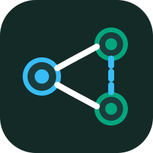

# Hi, I'm Simran Dangol 👋

Software Engineer specializing in modern full-stack web applications, real-time streaming architectures, and intelligent agentic AI systems. Focused on robust system design, high-performance APIs, real-time concurrency, and continuous hands-on learning across the full development stack.

 

 

---

### ⚙️ Technologies & Tools

  <!-- Line 1: AI, Languages & Core Frameworks -->
  &nbsp;
  &nbsp;
  &nbsp;
  &nbsp;
  &nbsp;
  &nbsp;
  &nbsp;
  &nbsp;
  &nbsp;
  &nbsp;
  
    
  <!-- Line 2: AI Retrieval, Databases & DevOps -->
  &nbsp;
  &nbsp;
  &nbsp;
  &nbsp;
  &nbsp;
  &nbsp;
  &nbsp;
  &nbsp;
  &nbsp;
  

 

---

### 📊 Engineering Metrics & Activity

  
  

 

  

